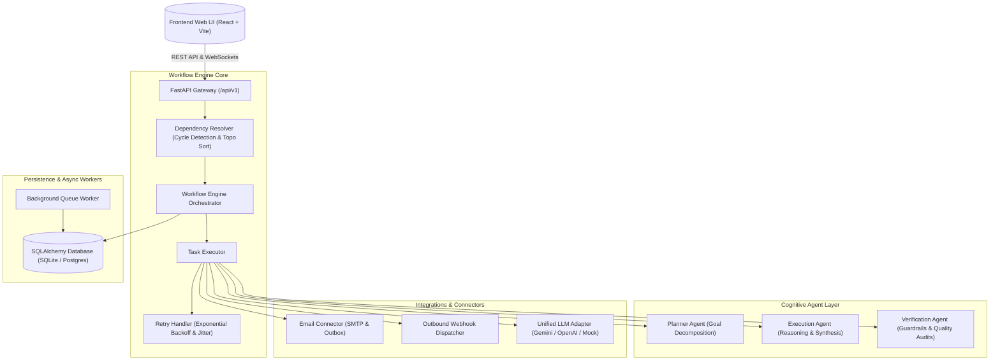

# AI Workflow Automation System — Architecture & Design

The **AI Workflow Automation System** is an enterprise-grade platform that orchestrates autonomous AI agents, business logic, and third-party integrations into Directed Acyclic Graphs (DAGs).

---

## 1. High-Level Architecture Overview

---

## 2. Core Subsystems

### A. Directed Acyclic Graph (DAG) Engine
- **Kahn's Algorithm & Cycle Detection**: Workflows are rigorously validated before creation or execution. Any cyclical references (`A -> B -> A`) are caught immediately and rejected with descriptive diagnostics.
- **Topological Phasing & Parallel Concurrency**: Nodes whose prerequisite inputs are satisfied run concurrently up to configured `MAX_CONCURRENT_STEPS`.
- **Dynamic Variable Interpolation**: Downstream nodes reference previous step outputs using syntax like `{{steps.node_trigger.output.payload.customer_email}}` or environment values `{{env.API_KEY}}`.
- **Conditional Branching**: Condition gate nodes evaluate boolean expressions (`==`, `!=`, `>`, `<`, `contains`), activating matching outgoing edges while automatically marking non-matching branches as `SKIPPED`.

### B. Cognitive Multi-Agent System
- **Planner Agent (`planner_agent.py`)**: Analyzes broad objectives, extracts unstructured input constraints, and designs a phased task list with schema assertions.
- **Execution Agent (`execution_agent.py`)**: Executes complex semantic tasks including sentiment classification, text synthesis, data aggregation, and code/JSON generation.
- **Verification Agent (`verification_agent.py`)**: Operates as an automated quality gate. It audits outputs against safety policies, confidence thresholds, and schema assertions. If the confidence falls below threshold, it signals the Retry Handler to adjust and rerun.

### C. Resilient Retry & Error Recovery
- **Exponential Backoff with Random Jitter**:
  $$\text{delay} = \min\left(\text{base} \times 2^{\text{attempt}} + \text{jitter},\, 15.0\right)$$
- Step executions record retry attempts, failure stack traces, and intermediate logs.

---

## 3. Database Schema

- **`workflows`**: Workflow definitions, metadata, node layout, and edge connections stored as JSON documents.
- **`workflow_schedules`**: Cron triggers and recurrence state.
- **`executions`**: Execution run records, overall status (`PENDING`, `RUNNING`, `COMPLETED`, `FAILED`, `CANCELLED`), duration, and output payload.
- **`step_executions`**: Node-level execution records, input data, output data, retry count, and duration.
- **`execution_logs`**: Chronological trace events, log levels (`INFO`, `AGENT_THOUGHT`, `WARN`, `ERROR`), and metadata.
- **`users`**: API keys and service authentication credentials.
